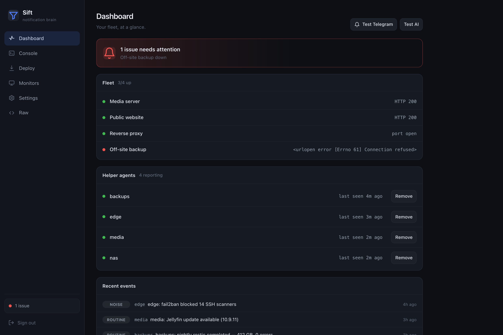
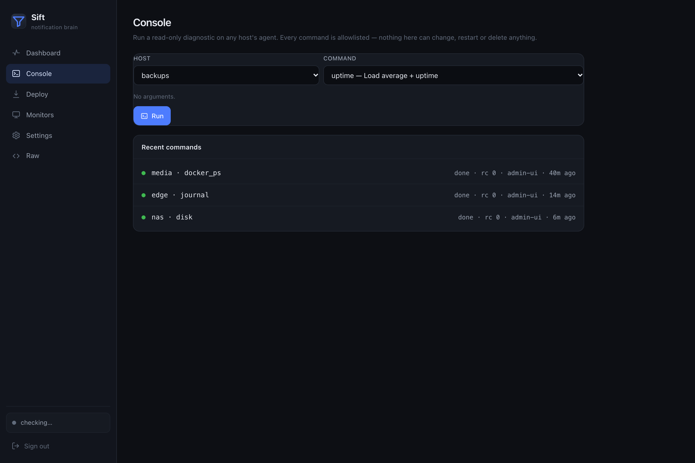
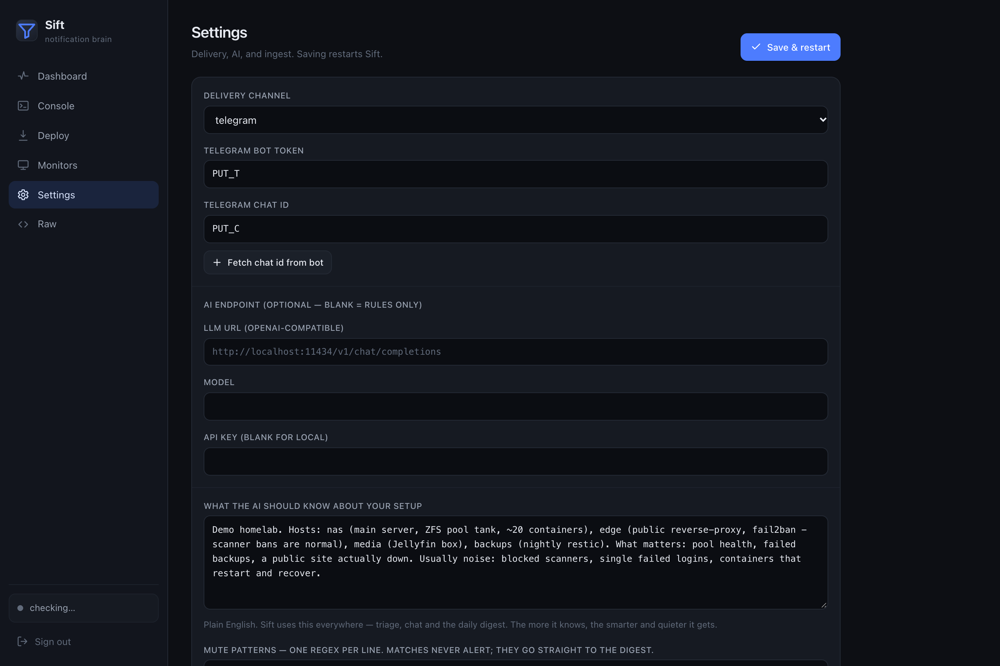

<p align="center">
  
</p>

<p align="center">
  <a href="LICENSE"></a>
  
  
  
  
</p>

<p align="center"><b>An AI notification brain for your homelab — a smarter, quieter <code>ntfy</code>.</b></p>

Sift ingests events from everything you run, lets an LLM triage and correlate them, and
only pushes the **urgent + actionable** ones to your phone. Everything routine goes into a
once-a-day plain-English digest. It watches your servers and tells you the moment one goes
down, runs a lightweight agent on each host, and lets you **ask it anything** or **run
read-only diagnostics on any host** from a web console or Telegram.

The AI is **optional**: with no model configured, Sift still de-dupes, routes and digests
using rules. One small container, **zero Python dependencies** (stdlib only).

## Watch

https://github.com/user-attachments/assets/fbd6efb0-804f-4553-bbb5-ff20363f56a7

## Screenshots

<p align="center">
  
</p>
<p align="center">
  
  &nbsp;
  
</p>

## Why

Self-hosters drown in notifications — hourly "update available" nags, flapping indexers,
scanner noise, chatter — so the one alert that matters (a dying disk, a failed backup) gets
lost. Sift fixes the signal-to-noise problem, not just the delivery: it understands *your*
setup and only interrupts you when something genuinely needs you.

## Features

- **AI triage** — classifies each event (critical / urgent / routine / noise), summarises
  it, and groups events that share a root cause ("3 sites down = the tunnel, not 3 alarms").
  Works with **any OpenAI-compatible endpoint** (Ollama, vLLM, LM Studio, OpenAI, Groq…).
- **Incidents, not alert spam** — related events join one incident with open → resolved state.
  Repeats don't re-alert; recoveries close it ("✅ resolved after 47m"); history is kept so
  the assistant can answer "did the mail server go down this week, and for how long?".
- **Learns what's normal** — each event is fingerprinted (timestamps, IPs, ids stripped); a
  shape it has already judged reuses that verdict without another LLM call.
- **Investigates before it pings you** — on an urgent/critical incident it runs 2–3 relevant
  read-only diagnostics on that host and replies under the alert with the likely cause.
- **Talk back to alerts** — reply `ack` (stop reminders), `mute` / `mute 3d` (learned
  suppression), `fixed` (close it) or `this mattered` (always alert on this kind). Unacked
  criticals are re-sent every 2h (max 3). Optional quiet hours hold urgent (never critical) alerts.
- **Watchdogs for things that should happen** — `expect` rules raise a critical when e.g. the
  nightly "backup OK" message stops arriving.
- **Knows your setup** — a plain-English `ai_context` you write once (your hosts, what
  matters, what's normal noise) steers triage, chat and the digest. The single biggest
  "make it smart" lever.
- **AI-optional** — no model? Rules-only mode (keyword triage + deterministic routing) still
  works, and Sift **fails open** (LLM down → events pushed raw, never dropped).
- **Deterministic safety rail** — events matching your `critical_bypass` regexes (dying
  drive, failed backup, disk full…) push **immediately, without the LLM**. `mute_patterns`
  do the reverse: known noise goes straight to the digest, never alerts.
- **ntfy-compatible ingest** — publishers that POST to ntfy migrate by changing only the
  URL. `POST /<topic>` with a text body, or `POST /notify` with JSON. Bearer, `X-Sift-Token`,
  or HTTP Basic auth.
- **Fleet monitoring** — Sift actively checks your servers/services (HTTP/TCP). A target must
  fail twice in a row before it's DOWN (no blips), targets that fail together arrive as ONE
  message, and state survives restarts.
- **Host agents** — a tiny bash agent on each host (zero deps) reports health (disk / ZFS /
  SMART / unhealthy containers) and forwards error logs for the AI to triage. Dead-man's
  switch: if a host goes silent, Sift tells you.
- **Remote read-only diagnostics** — from the web Console or Telegram, run an **allowlisted**
  diagnostic on any host (`disk`, `mem`, `zpool`, `docker ps/logs`, `smart`, `journal`,
  failed units, top procs, listening ports…) and read the output back. No shell, no inbound
  connections, nothing that can change anything.
- **Ask it anything** (Telegram) — "are my servers up?", "why did X go down?", "what's eating
  disk on host1?" — every message carries a live situation report (open incidents, recent
  outages with durations, monitors, agents, noise), and it *runs diagnostics itself* to answer.
  Read-only, allowlisted to you, with short-term memory. Every exchange is logged (Console →
  Bot conversations) so a bad answer can be debugged.
- **Reliable delivery** — alerts go through an outbox that retries for 24h, so a Telegram or
  network blip never loses one.
- **Web UI** — dashboard (fleet + agents + events), one-line agent installer, console,
  monitors, delivery/AI/ingest settings, raw config. Admin-password gated, offline-capable
  (no CDN).
- **Pluggable delivery** — Telegram, ntfy, Discord, Slack, or a generic webhook.

## Architecture

```
publishers ─┐                              ┌─► Telegram / ntfy / Discord / …
            ├─► Sift server (triage, AI, ──┤
host agents ┘    monitors, web UI, DB)     └─► daily digest

host agents dial OUT only: heartbeat, metrics, logs, and long-poll for
read-only commands. Sift never connects into a host — no inbound ports,
no stored SSH keys. Works through any existing reverse proxy / tunnel.
```

## Quickstart (server)

```sh
git clone https://github.com/<you>/sift && cd sift
cp config.example.json data/config.json
cp compose.example.yml compose.yml      # then edit the port binding to taste
# edit data/config.json: delivery channel + (optional) llm endpoint + ingest_token
docker compose up -d --build
```

Or without Docker: `python3 sift.py data/config.json` (stdlib only, Python 3.9+).

Open the web UI at `http://<host>:8130/` and set an admin password. First-run setup asks for a
one-time **setup code** printed in the server log (`docker logs sift | grep "setup code"`), so
nobody else can claim a fresh install. Then publish a test event:

```sh
curl -H "Authorization: Bearer $INGEST_TOKEN" \
     -H "Title: Backup failed" \
     -d "restic exited 1 on the nightly run" \
     http://localhost:8130/backups
```

## Add a host (agent)

From the web UI **Deploy** tab, or directly — run on the target host as root:

```sh
curl -fsSL https://<your-sift>/agent/install.sh \
  | sudo SIFT_SERVER=https://<your-sift> SIFT_TOKEN=<agent token> SIFT_HOST=myhost bash
```

This installs two tiny components (pick with `SIFT_COMPONENTS=both|daemon|collector`):

- **collector** (systemd timer, every 5 min; cron where there's no systemd) — pushes health
  (disk + inodes, ZFS, SMART, unhealthy / crash-looping / failed containers) and new error
  logs. If Sift is unreachable it spools to disk and catches up later — nothing is lost.
- **exec daemon** (`systemd`, sandboxed) — long-polls for read-only diagnostic commands.

The same command **upgrades** a host in place — on an existing install a bare
`curl -fsSL https://<your-sift>/agent/install.sh | sudo bash` keeps its server, token, host
name and any extra settings in `/opt/sift-agent/agent.env`. Plain `http://` is only allowed
for LAN addresses. The token is never put on a command line once installed (it lives in a
`0600` file), so it doesn't show up in `ps`.

Remote hosts use your public URL (e.g. `https://sift.example.com`) — it reuses whatever
reverse proxy / tunnel you already have; no per-host tunnel needed. **Remove** a host any
time from the Dashboard — the agent tears itself down on its next poll.

## Making it smart

In **Settings → "What the AI should know about your setup"**, describe your world in plain
English, e.g.:

> *Hosts: `nas` (main server, ZFS pool `tank`, ~20 containers — watch the OS disk filling).
> `edge` (public reverse-proxy with fail2ban — scanner bans are normal, not incidents).
> What matters: pool health, failed backups, a public site actually down. Usually noise:
> blocked scanners, single failed login probes, containers that restart and recover.*

Triage, chat and the digest all use it, so Sift stops crying wolf and starts sounding like it
actually knows your rack.

## Telegram setup (optional but recommended)

1. Message **@BotFather** → `/newbot` → copy the **bot token** into Settings.
2. Message your new bot once, then click **Fetch chat id** in Settings (or use
   **@userinfobot**). Only `authorized_chat_ids` may use the interactive chat.

## Configuration

Everything lives in `config.json` (see `config.example.json` for the annotated template).
Most of it is editable from the web UI.

| Key | What |
|---|---|
| `llm` | **Optional.** OpenAI-compatible endpoint + model (+ `api_key` for cloud). Remove to run rules-only. |
| `ai_context` | Plain-English description of your setup; steers triage, chat and digest. |
| `delivery.channel` | `telegram` \| `ntfy` \| `discord` \| `slack` \| `webhook` |
| `ingest_token` | shared secret for publishers/webhooks, sent as `Authorization: Bearer …`, `X-Sift-Token: …`, or Basic auth. Empty or the example value = ingest refused. |
| agent tokens | each host gets its own token from the **Deploy** tab (bound to that host name). `allow_shared_agent_token` lets old agents keep using `ingest_token` until their own token is first used. |
| `monitors` | list of `{name, type: http\|tcp, url\|host+port, agent_host?}` to watch (`agent_host` lets auto-investigation run diagnostics on the right box) |
| `expect` | `{name, match, source?, every_hours}` — critical if a matching event stops arriving |
| `quiet_hours`, `timezone` | `{start:"23:00", end:"07:00"}` holds urgent alerts overnight; IANA timezone for quiet hours and the digest |
| `auto_investigate`, `investigations_per_hour` | run diagnostics on urgent incidents and reply with a likely cause |
| `untrusted_sources` | regex of sources whose text outsiders can influence (default `^(logs-\|security)`) — fenced off from the AI, never resolves alerts |
| `monitor_confirm`, `renotify_hours`, `incident_stale_hours`, `retention_days` | tuning |
| `critical_bypass` | regexes that push immediately, no LLM |
| `mute_patterns` | regexes filed straight to the digest, never alerted |
| `triage_interval_seconds`, `digest_hour_local`, … | timing |

## Security

- **Agents are outbound-only.** Sift never connects into a host; there are no inbound agent
  ports and no SSH keys stored. Remote commands travel over the agent's own long-poll.
- **Remote exec is read-only and allowlisted.** The server can only queue a fixed menu of
  diagnostics; the agent re-validates and runs them as an argv array (no shell, so no
  injection). Nothing in the menu can write, install, restart or delete.
- **The Telegram chat is allowlisted** to your chat id(s) and cannot trigger uninstall or
  anything outside the read-only menu.
- **Per-host agent tokens.** A host's token can only heartbeat, poll and answer commands for
  that host — one leaked token can't impersonate the rest of the fleet.
- **Log text is untrusted.** Forwarded logs and IDS alerts are triaged in a separate,
  fenced-off batch, can never auto-resolve an alert, and reach the chat model only as short
  labelled excerpts.
- **Admin hardening:** first-run setup code, rate-limited login, sessions signed with a random
  server secret, secrets masked in the UI/API, validated + atomic config saves, request size
  limits and timeouts.
- Keep `config.json` private — it holds your tokens. It (and `data/`, `*.db`, `compose.yml`)
  are git-ignored by default.

## License

MIT — see `LICENSE`.
